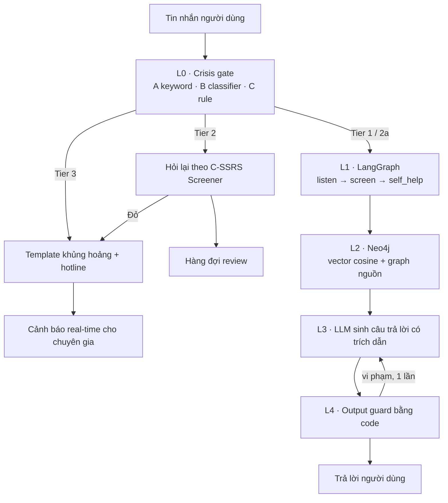

# Kiến trúc

Nguyên tắc: **an toàn khủng hoảng không phụ thuộc vào LLM hội thoại.** Hệ thống có 5 lớp; mỗi lớp có một nhiệm vụ và một đầu ra kiểm thử được.

## Quyết định đã chốt

| # | Quyết định |
| --- | --- |
| D1 | Neo4j vừa làm graph vừa làm vector store (cosine); không dùng vector DB riêng |
| D2 | Không dùng SHACL; dùng constraint Neo4j + Pydantic khi nạp dữ liệu |
| D3 | Crisis gate chạy độc lập với LLM hội thoại, trên mọi tin nhắn |
| D4 | Rule an toàn viết bằng code; system prompt chỉ lo giọng điệu và trích nguồn |
| D5 | Classifier trả 2 trục: `cssrs_level` (mức nặng) và `confidence` (độ chắc) |
| D6 | Câu trả lời khủng hoảng và câu hỏi sàng lọc là template cố định |
| D7 | Rủi ro "dính" trong phiên: đã chạm Vàng thì không về Xanh |
| D8 | Không dựa vào fine-tune cho an toàn |

## Lớp ↔ thư mục

| Lớp | Code | Dữ liệu |
| --- | --- | --- |
| L0 | `backend/app/safety/l0/` | `data/safety/crisis_lexicon.yaml`, `data/prompts/l0_classifier.md` |
| L1 | `backend/app/agents/`, `backend/app/screening/` | `data/templates/` |
| L2 | `backend/app/knowledge/`, `backend/app/db/neo4j.py` | `data/knowledge/` |
| L3 | `backend/app/llm/` | `data/prompts/l3_system.md` |
| L4 | `backend/app/safety/l4/` | `data/safety/output_guard.yaml` |
| HITL | `backend/app/hitl/`, `frontend/src/app/clinician/` | — |

## Tech stack

| Thành phần | Công nghệ | Nền tảng deploy |
| --- | --- | --- |
| Backend | FastAPI + Python 3.11 | Render / Railway |
| Agent | LangGraph + LangChain | — |
| LLM | GPT-4o-mini / Gemini | OpenAI / Google API |
| Database | PostgreSQL (dữ liệu ứng dụng, log an toàn, checkpoint LangGraph) | Supabase |
| Tri thức + vector | Neo4j (vector index cosine) | Neo4j AuraDB |
| Frontend | Next.js (App Router, TypeScript) | Vercel |
| DevOps | Docker + GitHub Actions | GitHub |
| Migration DB | Flyway (SQL thuần, `database/postgres/`) | chạy trong CI và trước mỗi lần deploy |
| Monitoring | Langfuse / LangSmith (chỉ dữ liệu đã ẩn PII) | Cloud / self-host |

Bảng stack gợi ý của chương trình có pgvector/ChromaDB. Dự án dùng Neo4j theo D1 vì cần lọc theo graph nguồn trong cùng một truy vấn.
