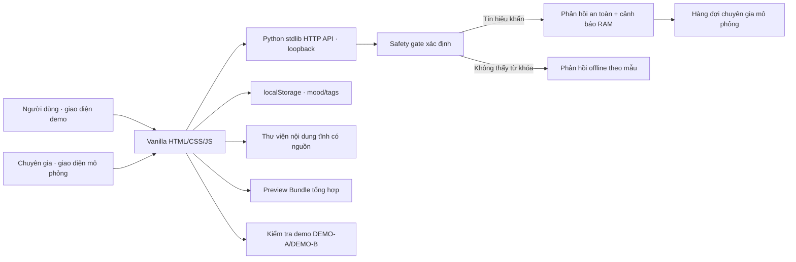

# Kiến trúc demo

Không có LLM, cơ sở dữ liệu thật, đăng nhập, phân quyền, gửi SMS hoặc EHR trong demo. Không lưu nội dung chat; cảnh báo giữ trong bộ nhớ tiến trình. Nhật ký cảm xúc lưu cục bộ trong trình duyệt.
